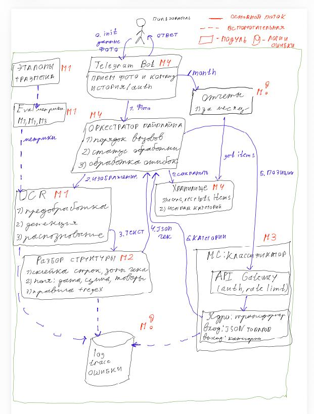

# receipt-tracker

Трекер расходов по фотографиям чеков.

Сфотографировал чек, отправил Telegram-боту и через пару секунд получил ответ: где была покупка, на какую сумму и как траты делятся по категориям — продукты, бытовая химия и так далее. Если бот ошибся с категорией, её можно поправить одной кнопкой. А в конце месяца бот покажет, куда ушли деньги, какие категории самые затратные и как это соотносится с прошлым месяцем.

Никаких таблиц и ручного ввода — только фото чека.

Проект учебный, разрабатывается командой из четырёх человек осенью 2026 года.

## Модули

- **M1 (OCR)**: принимает фото чека и возвращает распознанный текст с координатами.
- **M2 (разбор структуры)**: превращает текст в JSON-чек (дата, сумма, товары). Поля извлекаются правилами, без LLM.
- **M3 (классификатор)**: распределяет товары по категориям с помощью трансформера и строит отчёты за месяц.
- **M4 (бот, оркестратор, хранилище)**: общается с пользователем, вызывает M1, M2 и M3 по очереди и сохраняет данные.

## Архитектура



Подробное описание: [docs/architecture.pdf](docs/architecture.pdf).

## M4: бот, пайплайн и хранилище

Telegram-бот на aiogram 3. Принимает от пользователя фото чека и команды, передаёт фото в пайплайн и отвечает магазином, датой, суммой и списком покупок. Если часть покупок распознать не удалось или их сумма не сходится с итогом, бот предупреждает об этом, во втором случае предлагает удалить чек через `/undo`. Сам бот чеки не разбирает и не знает, как устроены остальные модули.

Команды:

- `/start` — приветствие;
- `/help` — справка;
- `/month` — сумма расходов и число чеков за текущий месяц; `/month MM.YYYY` — за выбранный месяц;
- `/history` — последние 5 чеков: дата, магазин, сумма;
- `/undo` — удалить последний сохранённый чек, например если OCR ошибся в сумме;
- фото чека — бот скачивает его в максимальном разрешении и отдаёт пайплайну. Чек можно прислать и файлом-изображением, тогда Telegram не сжимает его и OCR работает точнее. Файлы больше 20 МБ бот не скачивает: Bot API их не отдаёт. Если изображение больше, чем принимает OCR (по размеру в пикселях), бот просит уменьшить его, а не переснять. Пока чек распознаётся, бот показывает статус «печатает…».

Пайплайн (`pipeline/receipt.py`) вызывает этапы по очереди: распознавание текста с координатами (M1), разбор чека с товарными позициями (M2, `extract.parse_ocr_result`) и сохранение в хранилище. Распознавание выполняет M1 через общий контракт `OcrEngine` (`common/ocr.py`): движок выбирается переменной `OCR_ENGINE`, а при `OCR_ADAPTIVE=true` Tesseract запускается в нескольких PSM-режимах и пайплайн сохраняет лучший разбор. Если изображение не открывается или на чеке не нашлись ни дата, ни сумма, пайплайн выбрасывает `ReceiptUnreadable`, чек не сохраняется, и бот просит переснять фото. Если сломался сам движок OCR (например, не установлен Tesseract), пайплайн пишет ошибку в лог и выбрасывает `RecognitionUnavailable`, а бот отвечает, что распознавание временно недоступно, не раскрывая подробностей. Для каждого чека в лог пишется, сколько заняли распознавание, разбор и сохранение: так видно, какой шаг тормозит.

Чеки хранятся в SQLite (`storage/receipts.py`), путь к файлу задаёт `BOT_DATABASE_PATH`. Чек относится к месяцу по дате на нём, а если дату распознать не удалось, то по времени отправки фото. Границы месяца считаются в часовом поясе `BOT_TIMEZONE`. Чеки без итоговой суммы учитываются в количестве, но не в сумме. Если чек похож на уже сохранённый (тот же магазин, дата и сумма), бот не сохраняет его сразу, а спрашивает кнопками: сохранить ещё раз или нет. Например, две одинаковые покупки в один день. Ожидающий ответа чек хранится в памяти бота, поэтому после перезапуска его нужно прислать заново. Если какое-то из этих полей не распознано, чек сохраняется всегда.

Язык ответов (русский или английский) выбирается по языку интерфейса Telegram у пользователя. Тексты и оформление чека лежат в `bot/texts.py`, меню команд тоже переведено.

Структура:

| Файл | Назначение |
|---|---|
| `bot/__main__.py` | точка входа, сборка пайплайна, регистрация команд, запуск polling |
| `bot/handlers.py` | обработчики команд и фото |
| `bot/service.py` | интерфейс сервиса, который вызывает бот |
| `bot/texts.py` | тексты на русском и английском, оформление чека |
| `bot/middleware.py` | выбор языка для каждого сообщения |
| `bot/config.py` | настройки из переменных окружения (`BOT_TOKEN`, `BOT_TIMEZONE`, `BOT_DATABASE_PATH`) |
| `pipeline/receipt.py` | порядок вызова этапов, обработка нераспознанных и повторных чеков, расходы за месяц, история |
| `storage/receipts.py` | интерфейс хранилища и реализация на SQLite |

Материалы о ходе разработки M4 лежат в папке `docs/m4/`. Описание итераций: [docs/m4/README.md](docs/m4/README.md).

### Запуск

```bash
make setup
uv sync --group dev --group ocr
brew install tesseract tesseract-lang  # для OCR_ENGINE=tesseract
cp .env.example .env  # вписать токен бота в BOT_TOKEN
uv run python -m bot
```

Тесты: `make test`.

Полная инструкция по локальному запуску (бот и M3 API): [docs/RUN.md](docs/RUN.md).

## Local OCR receipt reviewer

Install Ollama and pull the small Russian-capable CPU model:

```bash
ollama pull qwen2.5:1.5b-instruct-q4_K_M
```

Review a receipt OCR text file without sending it to a remote service or changing
the saved receipt:

```bash
uv run python -m extract.review path/to/receipt-ocr.txt
```

Or pipe OCR text through stdin. The JSON result includes a deterministic verdict
and summary, the model's separate verdict and issue suggestions, a proposed full text,
numeric-token preservation, and deterministic
parses of both original and proposed text. `safe_to_apply` is false if the model
is uncertain/incorrect, changes numeric tokens, or the proposal fails the
existing arithmetic checks. Treat every correction as a suggestion; the reviewer
does not overwrite parsed or stored receipts. Set `OCR_REVIEW_MODEL` and
`OLLAMA_HOST` in `.env` to select another local model or Ollama host.

The same Ollama model is used by M2 as a fallback only when deterministic parsing
reports warnings. Long OCR results are sent in overlapping chunks of up to 3,000
characters. Returned fields must be supported by OCR evidence: dates must occur in
the text, totals must occur on a total line, and item amounts must be adjacent to
the product name outside payment/discount lines. Existing parsed fields win on
conflict; model output is used only when the result scores better than the parser.
If Ollama is unreachable, the ordinary parser result is used.

M3 independently checks each classifier result through Ollama. The API keeps the
classifier's `categories` unchanged and adds `category_validation` (`agreed`,
`disagreed`, or `uncertain`) and `suggested_categories`. Suggestions are limited
to the classifier's known label vocabulary. If Ollama is unavailable, M3 returns
its normal classification with `category_validation: "uncertain"`. The existing
M3 categories remain selected when validation is uncertain.

## Разработка

После клонирования настройте окружение и запустите все проверки:

```bash
make setup
make check
```

Применить каноническое форматирование: `make format`. Подробные правила разработки описаны в
[CONTRIBUTING.md](CONTRIBUTING.md).

## Команда

- Андрей Карабанов
- Даниил Качанов
- Артем Зайцев
- Даниил Горляков

## Как участвовать

Правила разработки, оформления кода и коммитов описаны в [CONTRIBUTING.md](CONTRIBUTING.md).
