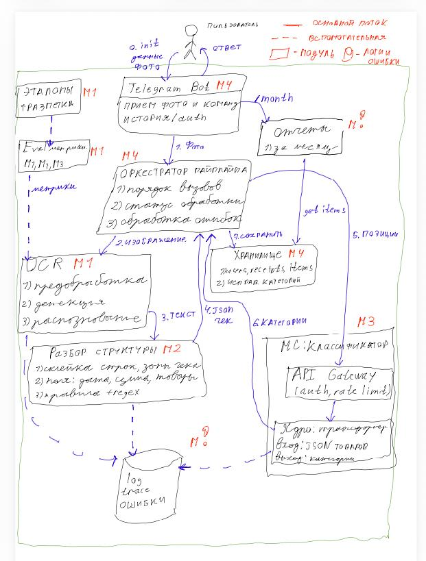

# receipt-tracker

Трекер расходов по фотографиям чеков.

Сфотографировал чек, отправил Telegram-боту и через пару секунд получил ответ: где была покупка, на какую сумму и как траты делятся по категориям — продукты, бытовая химия и так далее. Если бот ошибся с категорией, её можно поправить одной кнопкой. А в конце месяца бот покажет, куда ушли деньги, какие категории самые затратные и как это соотносится с прошлым месяцем.

Никаких таблиц и ручного ввода — только фото чека.

Проект учебный, разрабатывается командой из четырёх человек осенью 2026 года.

## Модули

- **M1 (OCR)**: принимает фото чека и возвращает распознанный текст с координатами.
- **M2 (разбор структуры)**: превращает текст в JSON-чек (дата, сумма, товары). Поля извлекаются правилами, без LLM.
- **M3 (классификатор)**: распределяет товары по категориям с помощью трансформера и строит отчёты за месяц.
- **M4 (бот, оркестратор, хранилище)**: общается с пользователем, вызывает M1, M2 и M3 по очереди и сохраняет данные.

## Архитектура



Подробное описание: [docs/architecture.pdf](docs/architecture.pdf).

## M4: бот и пайплайн

Telegram-бот на aiogram 3. Принимает от пользователя фото чека и команды, передаёт фото в пайплайн и отвечает магазином, датой и суммой чека. Сам бот чеки не разбирает и не знает, как устроены остальные модули.

Команды:

- `/start` — приветствие;
- `/help` — справка;
- `/month` — расходы за текущий месяц (пока недоступно, ждёт отчётов M3);
- фото чека — бот скачивает его в максимальном разрешении и отдаёт пайплайну.

Пайплайн (`pipeline/receipt.py`) вызывает этапы по очереди: распознавание текста (M1), затем разбор чека (M2, `extract.parse_receipt`). Если на чеке не нашлись ни дата, ни сумма, пайплайн выбрасывает `ReceiptUnreadable`, и бот просит переснять фото. Движок OCR подключается через интерфейс `TextRecognizer`. Пока его нет, стоит `NullRecognizer`, поэтому любое фото считается нераспознанным.

Язык ответов (русский или английский) выбирается по языку интерфейса Telegram у пользователя. Тексты и оформление чека лежат в `bot/texts.py`, меню команд тоже переведено.

Структура:

| Файл | Назначение |
|---|---|
| `bot/__main__.py` | точка входа, сборка пайплайна, регистрация команд, запуск polling |
| `bot/handlers.py` | обработчики команд и фото |
| `bot/service.py` | интерфейс сервиса, который вызывает бот |
| `bot/texts.py` | тексты на русском и английском, оформление чека |
| `bot/middleware.py` | выбор языка для каждого сообщения |
| `bot/config.py` | настройки из переменных окружения (`BOT_TOKEN`, `BOT_TIMEZONE`) |
| `pipeline/receipt.py` | порядок вызова этапов и обработка нераспознанных чеков |

### Запуск

```bash
make setup
cp .env.example .env  # вписать токен бота в BOT_TOKEN
uv run python -m bot
```

Тесты: `make test`.

## Разработка

После клонирования настройте окружение и запустите все проверки:

```bash
make setup
make check
```

Применить каноническое форматирование: `make format`. Подробные правила разработки описаны в
[CONTRIBUTING.md](CONTRIBUTING.md).

## Команда

- Андрей Карабанов
- Даниил Качанов
- Артем Зайцев
- Даниил Горляков

## Как участвовать

Правила разработки, оформления кода и коммитов описаны в [CONTRIBUTING.md](CONTRIBUTING.md).
