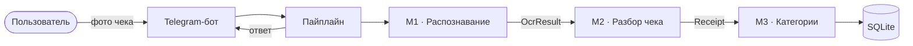

# Receipt Tracker

[](https://github.com/forafox/receipt-tracker/actions/workflows/ci.yml)


Учёт расходов по фотографии кассового чека. Пользователь отправляет фото Telegram-боту, бот распознаёт чек, находит магазин, дату, итог и каждую покупку, раскладывает покупки по категориям и сохраняет. В любой момент можно посмотреть, сколько потрачено за месяц и на что.

Без таблиц и ручного ввода: одно фото на одну покупку.

Учебный проект команды из четырёх человек, осень 2026.

## Как это выглядит

Ответ на фото чека:

```
Магазин: ПЯТЁРОЧКА
Дата: 05.10.2026 18:20
Сумма: 533.90

Покупки:
- МОЛОКО 3.2%: 89.90
- ХЛЕБ: 45.00
- ШАМПУНЬ: 300.00
- АСПИРИН: 99.00
```

Ответ на `/month`:

```
Расходы за 10.2026: 533.90
Чеков: 1
По категориям:
- personal_care: 300.00
- food: 134.90
- medicine: 99.00
```

## Возможности

- Приём чека фотографией или файлом-изображением без сжатия.
- Распознавание текста тремя движками на выбор: Tesseract, EasyOCR или визуальная модель Hunyuan OCR.
- Разбор чека: магазин, дата и время, итог, позиции с количеством, ценой и суммой, сверка арифметики.
- Категории покупок: продукты, быт, уход, лекарства, кафе.
- `/month` и `/month MM.YYYY`: расходы за месяц с разбивкой по категориям.
- `/history`: последние пять чеков. `/undo`: удалить последний сохранённый.
- Защита от двойного учёта: если чек похож на уже сохранённый, бот спрашивает, сохранять ли его ещё раз.
- Ответы на русском и английском, по языку интерфейса Telegram.

## Архитектура

Система разделена на четыре модуля, у каждого свой владелец. Модули обмениваются данными через общие типы из `common/`.



| Модуль | Что делает | Вход → выход | Пакеты | Владелец |
|---|---|---|---|---|
| M1, распознавание | находит текст на фото, проверяет качество изображения | фото → `OcrResult`: фрагменты текста с координатами | `ocr/` | Артём Зайцев |
| M2, разбор чека | собирает строки, находит поля и позиции, сверяет суммы | `OcrResult` → `Receipt` | `extract/` | Даниил Горляков |
| M3, категории | определяет категорию каждой позиции | название позиции → категории с уверенностью | `categorize/` | Даниил Качанов |
| M4, бот и пайплайн | общение с пользователем, порядок вызова модулей, хранение | сообщение Telegram → ответ | `bot/`, `pipeline/`, `storage/` | Андрей Карабанов |

Общие контракты (`common/`):

| Тип | Назначение |
|---|---|
| `OcrEngine` | интерфейс движка распознавания: `recognize_blocks(image) -> OcrResult` |
| `OcrResult`, `TextBlock` | распознанные фрагменты текста и их координаты |
| `Receipt`, `Item` | разобранный чек и его позиции |
| `ReceiptWarning` | коды некритичных проблем разбора: не найден итог, сумма позиций не сходится и другие |

### Путь чека

1. Бот скачивает фото и передаёт его пайплайну.
2. Пайплайн запускает движки распознавания. Если включён Hunyuan OCR и его результат удалось разобрать, используется он. Иначе из всех результатов выбирается лучший разбор.
3. M2 разбирает текст правилами. Если остались предупреждения, он может уточнить разбор локальной языковой моделью через Ollama.
4. Если на чеке нет ни даты, ни итога, бот просит переснять фото.
5. M3 определяет категории позиций. Модель работает в отдельном потоке, чтобы бот не замирал для остальных пользователей.
6. Чек сохраняется в SQLite. Если такой чек уже есть, бот спрашивает, сохранять ли его повторно.

## Стек технологий

| Область | Технологии |
|---|---|
| Язык и окружение | Python 3.12+, uv |
| Telegram | aiogram 3, aiohttp |
| Распознавание текста | Tesseract (pytesseract), EasyOCR, Hunyuan OCR через llama.cpp, OpenCV |
| Разбор чека | правила и регулярные выражения, необязательно Ollama (`qwen2.5:1.5b`) |
| Категории | PyTorch, Hugging Face Transformers, дообученная модель `cointegrated/rubert-tiny`, FastAPI для отдельного HTTP API |
| Данные и контракты | Pydantic, pydantic-settings |
| Хранение | SQLite |
| Качество | ruff, mypy (strict), pytest, pytest-asyncio, GitHub Actions |

Модель категорий обучена на 24 тысячах русских названий товаров. На отложенной выборке из 4 848 позиций exact match 0.888, micro F1 0.892. Подробности: [docs/m3_evaluation.md](docs/m3_evaluation.md).

## Структура репозитория

```
bot/          Telegram-бот (M4)
pipeline/     порядок вызова модулей, повторы, итоги за месяц (M4)
storage/      хранение чеков в SQLite (M4)
ocr/          движки распознавания и проверка качества изображения (M1)
extract/      разбор текста чека (M2)
categorize/   классификатор категорий: данные, обучение, модель, API (M3)
common/       общие контракты между модулями
tests/        тесты, по папке на модуль
scripts/      сквозные прогоны на наборах реальных чеков
docs/         инструкции, отчёты, журнал разработки M4
```

## Быстрый старт

Нужны Python 3.12+, [uv](https://docs.astral.sh/uv/) и Tesseract с русским языком.

```bash
git clone git@github.com:forafox/receipt-tracker.git
cd receipt-tracker

uv sync --locked --group dev --group ocr
brew install tesseract tesseract-lang        # macOS; для Linux см. docs/RUN.md

cp .env.example .env                         # вписать BOT_TOKEN от @BotFather
uv run python -m bot
```

Обученная модель категорий лежит в репозитории, обучать её не нужно.

В шаблоне `.env` включён Hunyuan OCR (`OCR_HUNYUAN_OCR_ENABLED=true`). Если локального сервера Hunyuan нет, поставьте `false`, иначе бот на каждом чеке сначала будет ждать ответа от него.

Полная инструкция для Linux и macOS, проверка установки и решение проблем: [docs/RUN.md](docs/RUN.md).

## Настройки

Все настройки читаются из `.env`, шаблон: [.env.example](.env.example).

| Группа | Переменные | Подробнее |
|---|---|---|
| Бот | `BOT_TOKEN`, `BOT_TIMEZONE`, `BOT_DATABASE_PATH`, `BOT_API_PROXY` | [bot/README.md](bot/README.md) |
| Распознавание | `OCR_ENGINE`, `OCR_ADAPTIVE`, `OCR_QUALITY_*`, `OCR_HUNYUAN_OCR_*` | [ocr/README.md](ocr/README.md) |
| Разбор | `OLLAMA_HOST`, `OCR_REVIEW_MODEL`, `KILO_API_KEY` | [extract/README.md](extract/README.md) |
| Категории | `M3_VALIDATION_MODEL` | [categorize/README.md](categorize/README.md) |

`KILO_API_KEY` отправляет текст каждого чека во внешний сервис OpenKilo. Оставьте его пустым, чтобы чеки не покидали вашу машину.

## Разработка

```bash
make setup     # зависимости для разработки
make check     # форматирование, ruff, mypy и тесты, как в CI
make format    # привести код к единому стилю
```

Тесты проходят примерно за 10 секунд и не требуют сети, Telegram, Tesseract или языковых моделей. Тесты с настоящими движками помечены `@pytest.mark.slow` и в обычный прогон не входят.

| Модуль | Тестов |
|---|---:|
| M1, распознавание | 86 |
| M2, разбор чека | 348 |
| M3, категории | 68 |
| M4, бот, пайплайн, хранилище | 81 |
| общие контракты | 11 |

Правила кода, веток и коммитов: [CONTRIBUTING.md](CONTRIBUTING.md).

## Состояние проекта

Работает весь путь от фото до итогов месяца. Что известно и ещё не доделано:

- 19 тестов разбора чека помечены как известные регрессии (`tests/extract/known_regressions.py`): после добавления Hunyuan OCR разбор ведёт себя иначе, чем описывают эти тесты.
- Для нескольких модулей в `pyproject.toml` временно отключены отдельные проверки mypy, у каждого исключения указана причина.
- В `common/` два описания чека: для разбора (`contracts.py`) и для API категорий (`models.py`).
- `Dockerfile` собирает только API категорий, бот запускается напрямую.

## Документация

| Документ | О чём |
|---|---|
| [docs/RUN.md](docs/RUN.md) | установка и запуск |
| [docs/README.md](docs/README.md) | оглавление всех документов |
| [ocr/README.md](ocr/README.md), [extract/README.md](extract/README.md), [categorize/README.md](categorize/README.md), [bot/README.md](bot/README.md) | устройство модулей |
| [docs/m4/README.md](docs/m4/README.md) | журнал разработки M4 |
| [docs/architecture.pdf](docs/architecture.pdf) | первая схема системы, нарисованная до начала разработки |

## Команда

| Участник | Модуль |
|---|---|
| Андрей Карабанов | M4: бот, пайплайн, хранилище |
| Артём Зайцев | M1: распознавание текста |
| Даниил Горляков | M2: разбор чека |
| Даниил Качанов | M3: категории |
