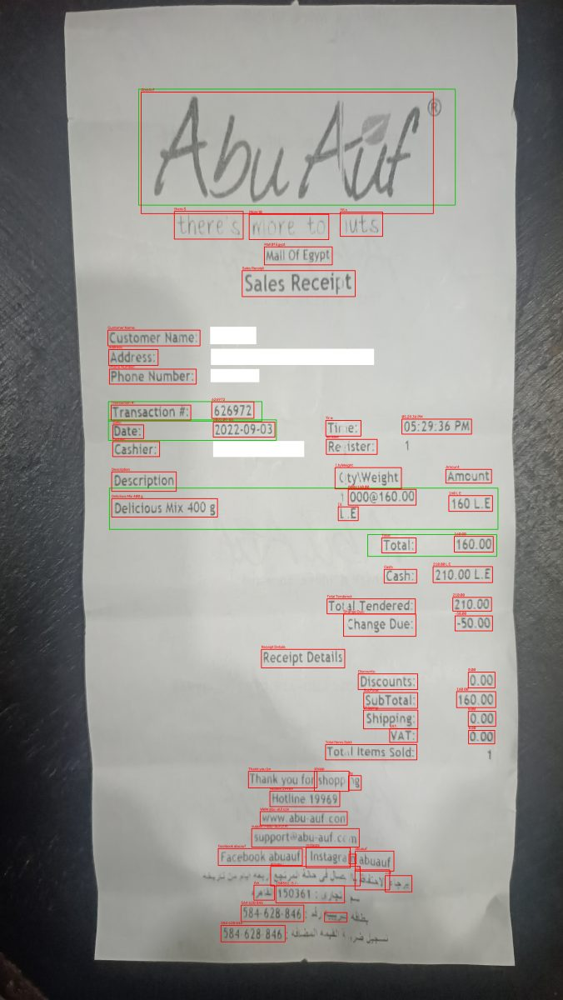
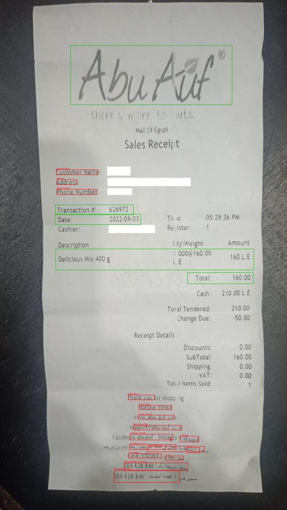

# Схема 

Схема модуля OCR проекта анализа чеков


### 1. Вход (вызов функции)
**`process_receipt(image)`** — точка входа. Принимает изображение чека (файл, ndarray, base64 — в зависимости от реализации), не сохраняет промежуточные данные, возвращает структуру чека или ошибку вызывающему коду.

### 2. Предобработка изображения
Приводит «сырое» изображение к виду, пригодному для детектора текста и OCR.
- **Декодирование / приведение к ndarray** — единый внутренний формат (numpy-массив).
- **EXIF-ориентация, поворот** — устраняет поворот, зашитый в метаданные камеры.
- **Проверка качества** — оценка резкости, бликов, контраста; при плохом качестве возвращается ошибка (нужен пересъём).
- **Исправление перспективы** — выравнивание чека по 4 углам (гомография).
- **Grayscale, шумоподавление** — уменьшение каналов и подавление шума.
- **Бинаризация** — адаптивный порог для отделения текста от фона.
- **Нормализация размера** — приведение к целевому разрешению для стабильной работы моделей.

### 3. Определение bbox текстов
Находит на изображении области, где есть текст.
- **Детектор текста** — CRAFT / DB / EAST (модель text detection).
- **NMS + порог по confidence** — удаление перекрывающихся и ненадёжных боксов.
- **Фильтрация мелких/ложных боксов** — отсев шума и артефактов.
- **Сортировка bbox** — подготовка к склейке в строки (обычно по Y, затем по X).

### 4. Распознавание текста внутри bbox
Превращает вырезанные области в строки текста.
- **Вырезание и выравнивание bbox** — crop + выравнивание перспективы/наклона.
- **OCR-модель** — CRNN / TrOCR / PaddleOCR.
- **Результат на каждый бокс** — распознанный текст, confidence, координаты.
- **Цикл** — повтор до обработки всех найденных боксов.

### 5. Определение структуры чека
Восстанавливает логическую структуру документа из «плоского» списка распознанных блоков.
- **Сортировка по Y, затем X** — упорядочивание в естественном порядке чтения.
- **Склейка близких bbox** — объединение в строки и смысловые блоки (например, «наименование — цена — количество»).
- **Классификация зон** — шапка, позиции, итоги, оплата, QR-код.
- **Извлечение полей** — дата, сумма, ИНН, ФН, ФД, ФПД, список товаров.
- **Нормализация и проверка сумм** — приведение чисел/дат к единому виду, проверка арифметики.
- **Валидация** — при ошибках возвращается частичный результат с флагами.

### 6. Формирование ответа
Упаковывает результат в удобный для вызывающего кода вид.
- **Сборка JSON / dataclass** — структурированный объект чека.
- **Добавление confidence и bbox** — диагностическая информация для отладки и доверия.
- **Возврат наружу** — без сохранения в БД/файл; ошибки качества и частичные результаты возвращаются тем же путём.

## Структура пакета

```
ocr/
  core/       # конфиг, ошибки, геометрия, порядок блоков, метрики
  engines/    # tesseract.py, easyocr.py, factory.py
  datasets/   # detection.py, recognition.py, viewer.py
  tools/      # preview.py, eval_ocr.py
```

## Движки OCR

Реализованы два взаимозаменяемых движка за общим контрактом из `common/ocr.py`:

| Движок | Класс | Зависимости |
|---|---|---|
| Tesseract | `ocr.engines.tesseract.TesseractEngine` | `pytesseract` + бинарь `tesseract` |
| EasyOCR | `ocr.engines.easyocr.EasyOcrEngine` | `easyocr` (первый запуск скачивает веса) |

Контракт:

- `TextBlock` — распознанный фрагмент: `text`, `bbox` (4 точки-полигона в пикселях), `confidence`.
- `OcrResult` — список блоков и размеры исходного изображения.
- `OcrEngine` — протокол с методами `recognize_blocks(image: bytes) -> OcrResult` и
  `recognize(image: bytes) -> str`. Второй метод совпадает с `pipeline.TextRecognizer`, поэтому
  движок можно передать в пайплайн без адаптера.

Выбор движка — через конфиг (`ocr.core.config.OcrSettings`, переменные окружения с префиксом `OCR_`):
`OCR_ENGINE`, `OCR_TESSERACT_LANGUAGES`, `OCR_EASYOCR_LANGUAGES`, `OCR_MIN_CONFIDENCE`, `OCR_GPU`.

### Примеры работы

Результат `ocr.tools.preview` на одном и том же чеке: зелёным — эталонные боксы из `dataset/`,
красным — предсказания движка.

| EasyOCR | Tesseract |
|---|---|
|  |  |

Примеры — уменьшенные копии вывода `ocr.tools.preview`; рабочие изображения пишутся в
`ocr/_preview/` и в репозиторий не коммитятся.


## Установка и запуск

```bash
uv sync --group dev            # бот и обычные тесты без тяжёлых движков
uv sync --group ocr            # движки OCR
uv run python -m ocr.tools.preview  --engine tesseract --source eng --split test --index 0
uv run python -m ocr.tools.eval_ocr --engine tesseract --task rec --source eng --split test --limit 50
uv run python -m ocr.tools.eval_ocr --engine tesseract --task det --source ru  --split test --limit 50
uv run python -m ocr.datasets.viewer --task det --source eng --split test --count 5
OCR_RUN_EASYOCR=1 uv run pytest -m slow
```

- `ocr.tools.preview` рисует на изображении эталонные боксы (зелёным) и предсказания движка
  (красным) и сохраняет PNG в `ocr/_preview/` (в `.gitignore`).
- `ocr.tools.eval_ocr` считает детекцию (precision/recall/F1, средний IoU) и распознавание (CER/WER,
  точное совпадение) на детерминированной выборке из `dataset/`.
- Тесты с реальными движками помечены `@pytest.mark.slow` и не входят в `make check`; EasyOCR
  дополнительно требует `OCR_RUN_EASYOCR=1`, так как скачивает модели.

## Изменения в ветке `refactor/ocr-reorganize-package`

- Пакет `ocr/` разделён на подпакеты: `core/`, `engines/`, `datasets/`, `tools/`.
- Модули переименованы под контекст: `tesseract.py`, `easyocr.py`, `detection.py`, `recognition.py`.
- Обновлены импорты в коде и тестах; публичный API `ocr/__init__.py` не изменился.
- Исправлены пути, зависящие от расположения модулей: `DATASET_ROOT` и `PREVIEW_DIR`.
- Новые точки входа: `python -m ocr.tools.preview`, `python -m ocr.tools.eval_ocr`,
  `python -m ocr.datasets.viewer`.
- `make check` проходит; slow-тест Tesseract проходит, EasyOCR требует `OCR_RUN_EASYOCR=1`.